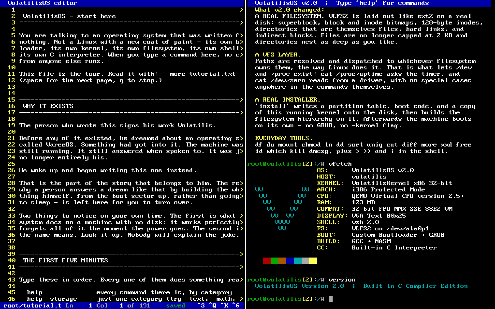
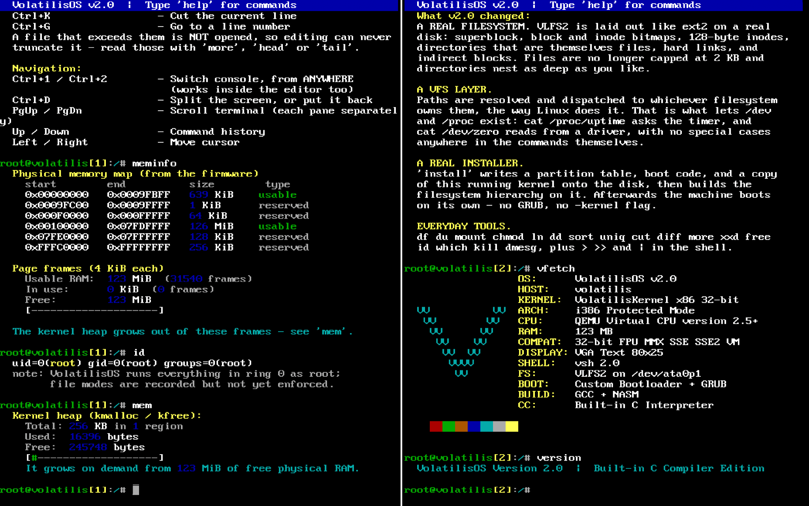

# VolatilisOS 2.0 Beta — historical archive

> **Archive preparation; ISO publication pending version verification.** This branch documents the recovered **VolatilisOS V2.0 Beta** generation. The ISO supplied for this archive was inspected and identifies itself as **VolatilisOS 2.1**, so it is **not** published here as V2.0. The correct V2.0 ISO is still needed. **No source code is distributed by this branch.**

**Latest public release:** [VolatilisOS 2.2 Beta, “Navy Horizon”](https://github.com/chanatun-volatilis/VolatilisOS/tree/main)  
**Next historical branch:** [VolatilisOS 2.1](https://github.com/chanatun-volatilis/VolatilisOS/tree/version-2.1)

VolatilisOS is an independently developed, experimental x86 operating-system project written in C and low-level assembly. This historical branch preserves the **2.0 Beta era** separately from the actively developed 2.2 release line.

## What we can verify about V2.0

Screenshots dated **1, 3 and 5 August 2026** visibly identify the CLI as **“VolatilisOS v2.0”**. In these images:

- The shell identifies itself as **vsh 2.0**, with multiple workspaces, command history and redirection/pipes.
- The screen shows an **80×25 VGA text interface**, an i386 protected-mode kernel and `vfetch` hardware/system information.
- The reported root filesystem is **VLFS2** on `/dev/ata0p1`. On-screen notes also describe a **VFS** routing paths to filesystems, `/dev` and `/proc`.
- A built-in **C interpreter**, command-line tools, an interactive text editor and a prototype `install` command are described or shown.
- The boot description mentions a **custom bootloader and GRUB**.

The existence of an installer command does **not** establish that V2.0 can safely install to a real computer. Treat all installation/disk writes as **experimental and unverified**. These are screenshot-grounded observations, not a fresh V2.0 source build or automated test report.

## ISO download

**Not yet available for V2.0 Beta on this branch.** The provided file `volatilis-master.iso` was checked against the accompanying `VOS V2.1 Beta.zip` and found to be byte-identical. Its GRUB menu labels the kernels *VolatilisOS v2.1 GUI Edition* and *VolatilisOS v2.1 CLI Edition*. Publishing it here as V2.0 would mislabel the release.

When a matching V2.0 ISO is provided, this section can list its actual filename, size, SHA-256 checksum, verified boot-menu label and a safe QEMU boot command. **No source archive or development files will be included.**

## August 2026 screenshots

### August desktop (build version not confirmed)


*August 27, 2026 — a desktop-era view. No exact V2.0 GUI version number is visible.*

### VolatilisOS V2.0 CLI






The author has now provided **original August screenshots** for this historical archive. The screenshots are selected below, with their exact build identity distinguished from their capture date. The **image files are not yet on GitHub**; download the separately prepared screenshot package and upload the four files to `screenshots/` to enable inline images. No unavailable links are shown as though they were already published.

### One desktop-era view (version not confirmed)

**27 August 2026 — Welcome, web browser and Programs launcher**

`Screenshot 2569-08-27 at 12.24.48.png` shows the blue windowed VolatilisOS desktop, a Welcome window, the graphical web browser and the application launcher. It does **not** show a V2.0 version banner, so it is an **August desktop-era illustration**, not proof that the particular GUI build is V2.0.

**Planned public filename:** `screenshots/august-desktop.png`

### V2.0 command-line interface (version explicitly visible)

| Capture date | Original screenshot | What it demonstrates |
| --- | --- | --- |
| **1 August 2026** | `Screenshot 2569-08-01 at 15.05.26.png` | V2.0 editor, `vfetch`, VLFS2 and VFS explanation, and `version` |
| **1 August 2026** | `Screenshot 2569-08-01 at 15.05.49.png` | V2.0 shell navigation/help, `meminfo`, `mem` and ring-0 permission caveat |
| **3 August 2026** | `Screenshot 2569-08-03 at 07.39.56.png` | V2.0 `meminfo`, `mem`, `id` and the firmware memory map |

These images visibly label the command-line OS **VolatilisOS v2.0**.

**Planned public filenames:**
- `screenshots/v2.0-cli-editor-vfetch.png`
- `screenshots/v2.0-cli-help-memory.png`
- `screenshots/v2.0-cli-memory-map.png`

I also reviewed the supplied **9 August** and **24 August** images that explicitly show `Volatilis OS v1.5`. They are **not used as V2.0 evidence**. Other August GUI images without visible version markers were not selected because this README keeps just one desktop-era screenshot, as originally requested.

For the exact selected originals, checksums and [upload/embedding instructions](docs/UPLOAD_CHECKLIST.md), see the [screenshot provenance record](docs/SCREENSHOT_PROVENANCE.md).

## Running historical builds

For the correct ISO, the conservative first test is a **fresh BIOS-mode QEMU guest with no host disks attached**:

```sh
# Replace this placeholder with the filename of a *verified* V2.0 ISO.
qemu-system-i386 -m 512 -cdrom VERIFIED_VOLATILIS_2_0_BETA.iso -boot d
```

This is an example for a future verified file, **not** a link to a build already available. Do not boot or install to physical storage as part of testing this archive.

## Documentation

- [V2.0 evidence and version-identification notes](docs/RELEASE_EVIDENCE.md)
- [Snapshot selection and provenance](docs/SCREENSHOT_PROVENANCE.md)
- [Commands and safety](docs/COMMANDS_AND_SAFETY.md)
- [Publish checklist for the verified ISO and four screenshots](docs/UPLOAD_CHECKLIST.md)

## Source and licensing

**No kernel source, VScript compiler source, private development tree, or V2.1 source archive is included in this release branch.** The source repository is separate and private. Copyright (C) 2025–2026 Chanatun Volatilis Poolcharuansin. All rights reserved, subject to applicable third-party licenses. This historical documentation is not a license grant to redistribute the OS source.
