# VolatilisOS
An operating system created from scratch by me, a young teen who is into Operating Systems and low level memory management programming, this project started when I was 12, (VolatilisOS Source isnt public yet) The development still continues to be active till this day, it features CLI and GUI interface, still under heavy development, ISO files can be downloaded here, on itch.io volatilis, Demonstration videos in tiktok VOLATILIS, YT account coming soon.

Volatilis Tiktok account:
https://www.tiktok.com/@alpha300332

Links to donwload in itch.io:
https://volatilis-2033.itch.io/volatilisos-v21

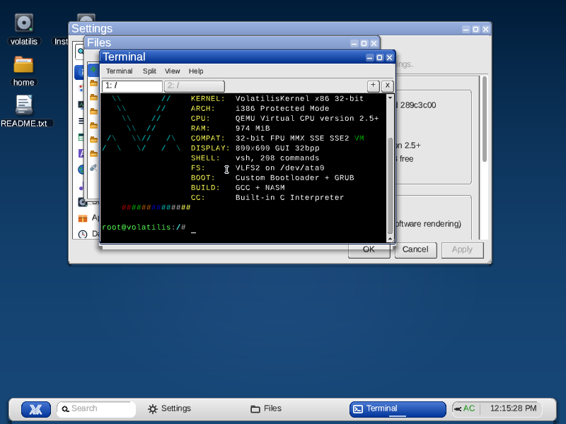

## Download (VolatilisOS 2.2 Beta)

There are three disc images in this repository. Pick one:

| File | What it is | Size |
| --- | --- | --- |
| [`volatilis-gui.iso`](volatilis-gui.iso) | **GUI edition only.** Boots straight into the graphical desktop. | 44 MB |
| [`volatilis-cli.iso`](volatilis-cli.iso) | **CLI edition only.** Boots into the text-only command line. Small and fast. | 10 MB |
| [`volatilis-master.iso.zip`](volatilis-master.iso.zip) | **Both editions on one disc**, plus the installer. Unzip it first (GitHub does not allow files over 100 MB, so it is zipped). | 66 MB zipped, 128 MB unzipped |

SHA-256 checksums, so you can check your download is not broken:

```
9aa0dc8badd7a3eb209b762fe23a4f183d8bda6010aba0c7f12da6f3b71612b5  volatilis-gui.iso
61c319ccdfc1813f437bc995e2c0cff74955ac1ea092c14778d8f4680d41817a  volatilis-cli.iso
71a2f3a9aaa3c88b476715db220e969fda5efc7e9c12e5b61d1d62698cb351d5  volatilis-master.iso.zip
b08f9500ae44a19022802d6476edf847b3bd8566fbeb527e233598543bd7ae94  volatilis.iso (inside the zip)
```

### How to try it

VolatilisOS is a 32-bit x86 system that boots with a normal (legacy BIOS) PC
or a virtual machine. The easiest way is QEMU:

```sh
qemu-system-i386 -m 1024 -cdrom volatilis-gui.iso      # the desktop
qemu-system-i386 -m 512  -cdrom volatilis-cli.iso      # the command line
```

In VirtualBox, make a new "Other / Unknown" 32-bit machine with 1 GB of memory
and put the ISO in its optical drive. Nothing is written to any disk unless you
choose **Install** and confirm it.

## What's new in 2.2 Beta

- **New boot experience.** A plain black-and-white GRUB menu that tells you what
  each choice does, then a VolatilisOS splash screen with the desktop's own
  colour icons, shown before the drivers start.
- **Installer restyle.** Setup now uses VolatilisOS's own window style with a
  depth (3D shadow) effect, mouse support, and a high-contrast mode.
- **New sign-in and lock screens**, redesigned as one simple sign-in card.
- **Redesigned Settings app** with a sidebar, search, and pages for
  personalization, display, desktop and taskbar, keyboard and mouse, network,
  storage, language, accessibility and more.
- **Better laptop support.** Mice and trackpads work on real laptops such as the
  HP ProBook (the system now takes the USB controllers over from the firmware
  properly), with two-finger scrolling and tap-to-click on Synaptics touchpads,
  plus laptop backlight control and a power button that asks before shutting down.
- **Wi-Fi groundwork:** a connection manager and the first step of an Atheros
  Wi-Fi driver with WPA2 security (still in progress, not usable yet).
- **NetSurf web browser** comes pre-installed on the desktop, with SVG images.
- **DOOM** (the open-source DoomGeneric engine with the free Freedoom game data).
- Clock, Calendar, 3D Chess, Image Viewer and Video Player are back, with new
  colour icons, a "volatilis" disk icon and a right-click folder menu.

## Screenshots

All screenshots below were taken from these exact ISO files, running in QEMU.

| | |
| --- | --- |
| 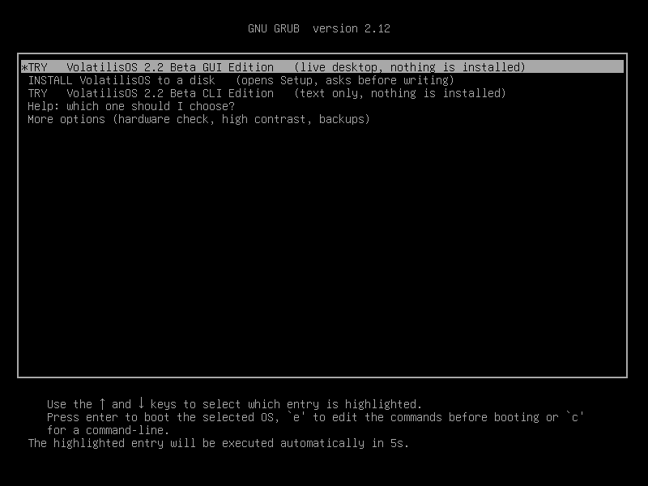 Boot menu (master ISO) | 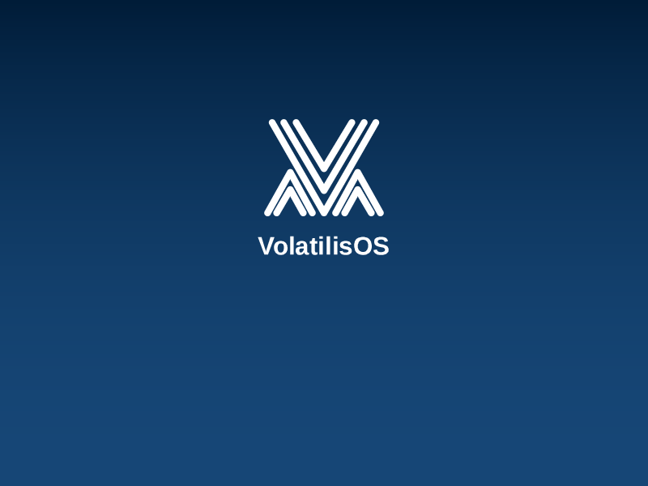 Boot splash |
| 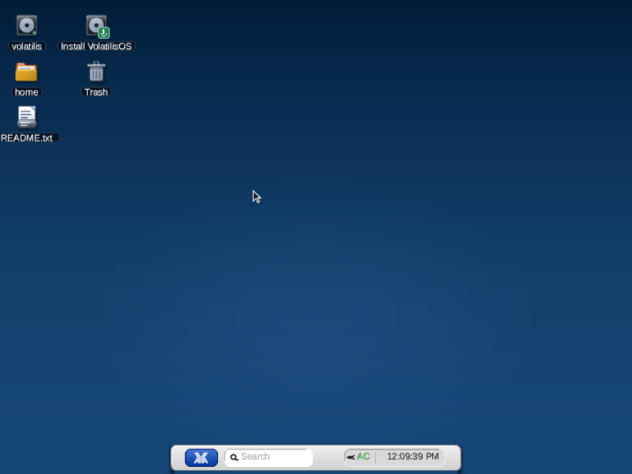 The desktop | 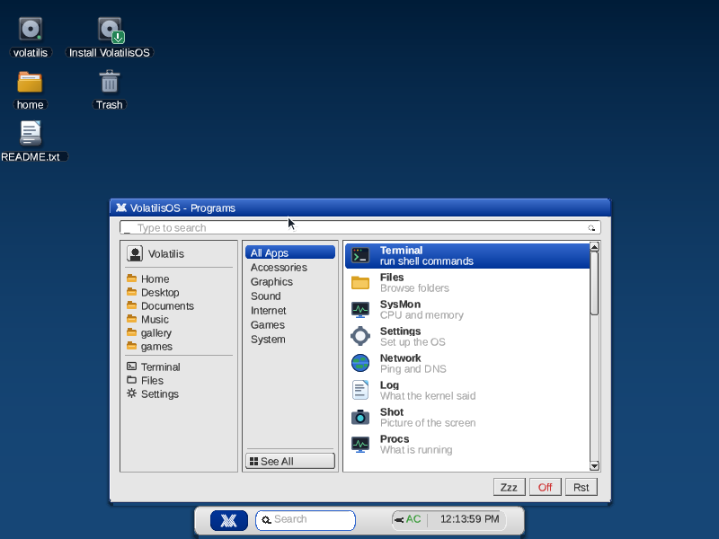 Start menu |
| 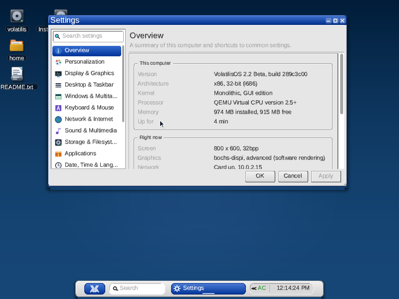 The new Settings app | 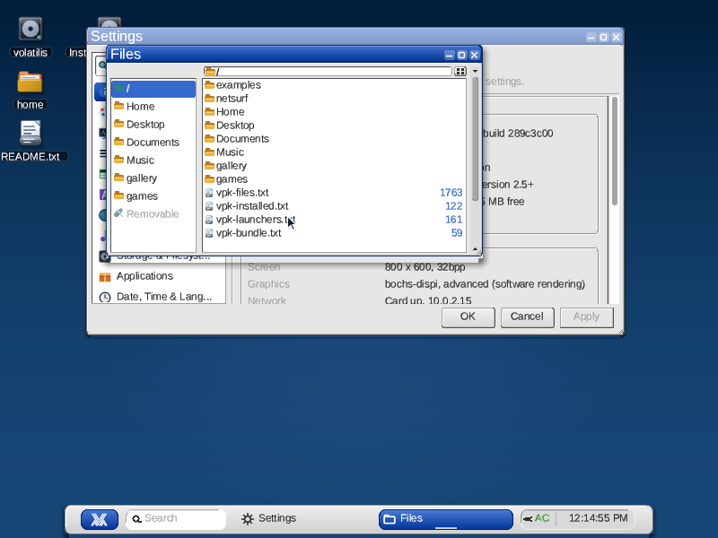 Files |
| 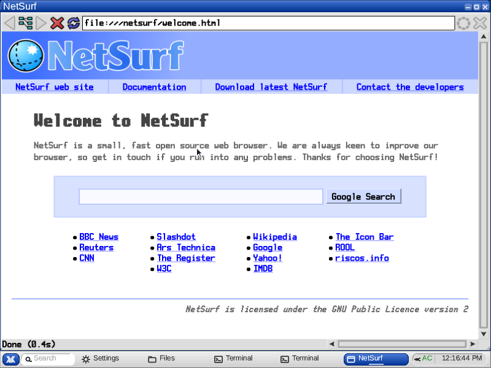 NetSurf web browser | 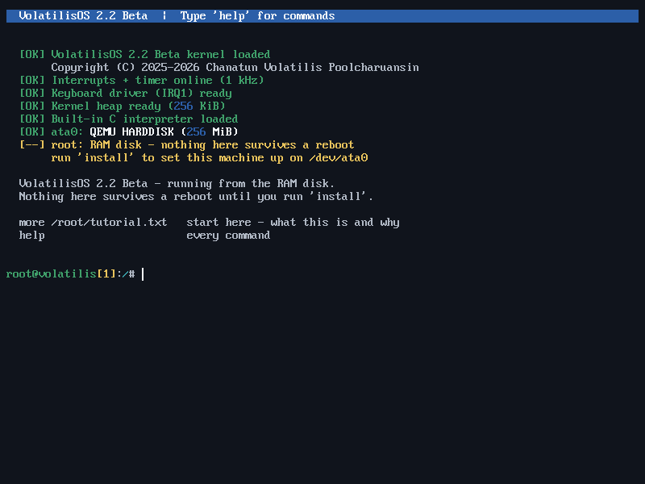 The CLI edition |

## Showcase

A closer look at the VolatilisOS 2.2 Beta desktop and its built-in apps.

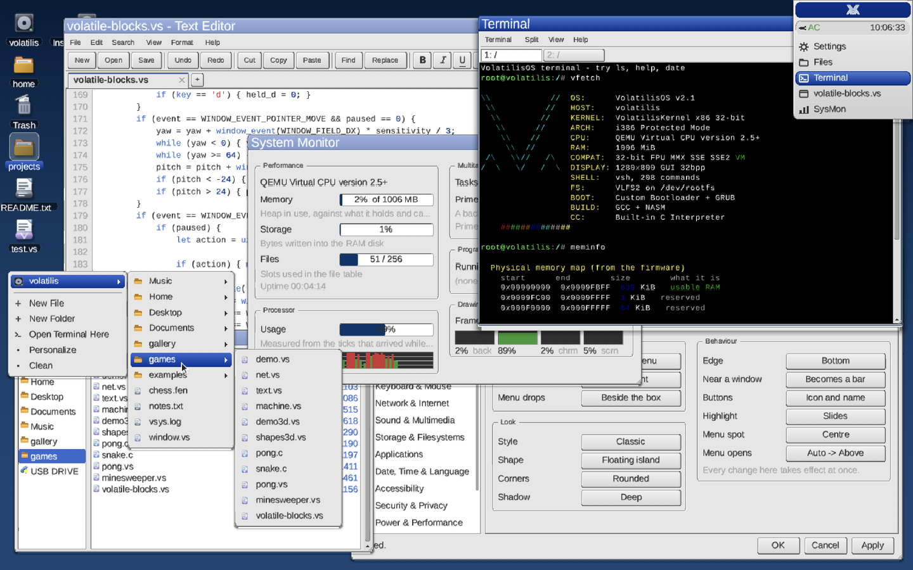
*A full workspace: Text Editor, Terminal, System Monitor and the desktop folder menu, all running at the same time.*

### The desktop and menus

| | |
| --- | --- |
| 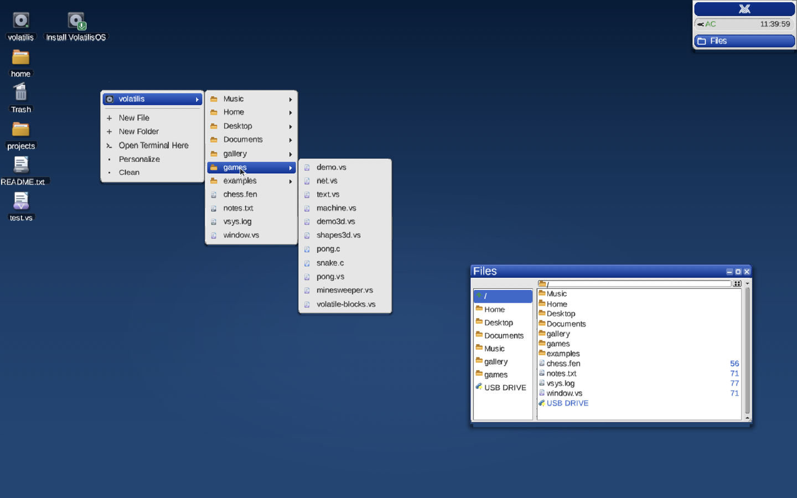 Right-click the desktop to open any folder straight from a menu |  The corner (start) menu with Applications, Places and Settings |

### Settings

| | |
| --- | --- |
| 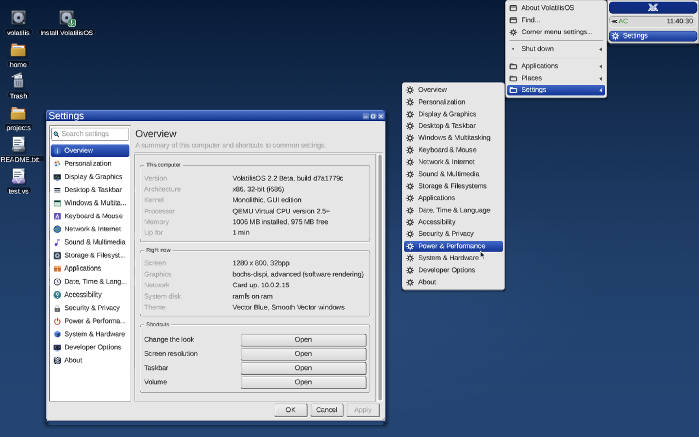 The **Settings** Overview page, with every Settings page also reachable from the corner menu |  Storage & Filesystems shows what is mounted, next to Files and the folder menu |

### Files and System Monitor

| | |
| --- | --- |
|  **Files** next to **System Monitor**, which shows memory, storage, CPU use and frames per second |  Opening System Monitor (SysMon) from Applications > System |

### Text Editor and Terminal

| | |
| --- | --- |
| 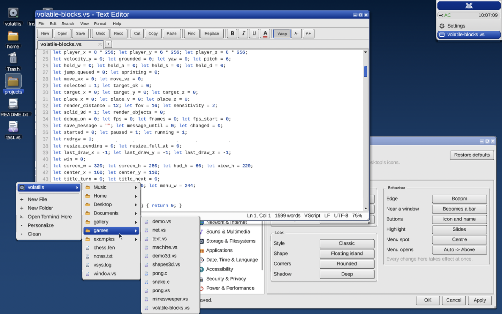 **Text Editor** with tabs, syntax colours, line numbers and Find/Replace, editing the VScript game `volatile-blocks.vs` |  **Terminal** running `vfetch` and `meminfo` |
