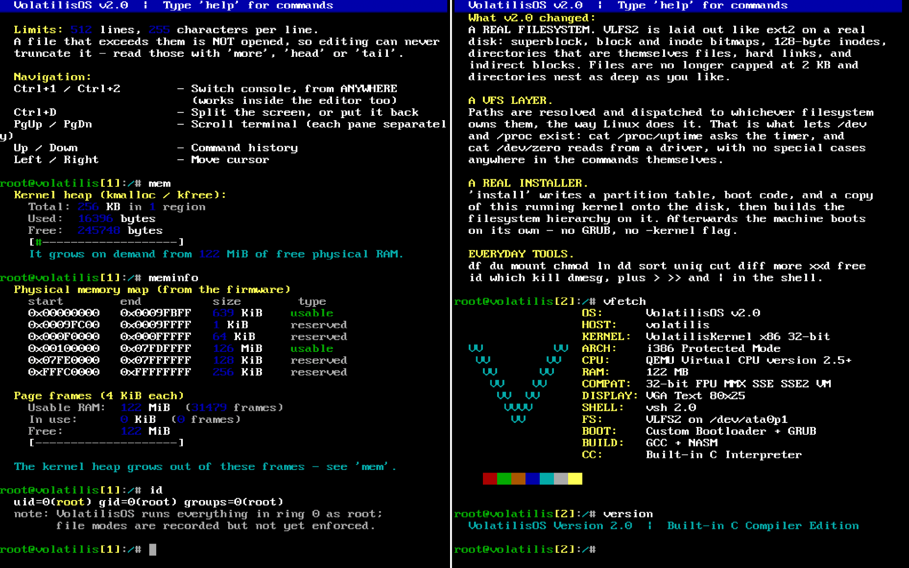
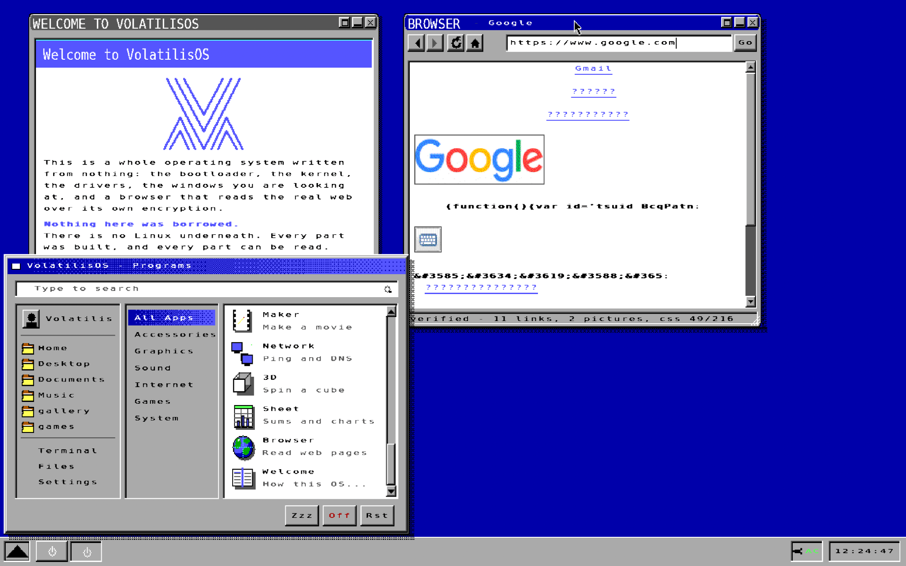

# VolatilisOS 2.0 Beta — historical archive

> **Archive preparation; ISO publication pending version verification.** This branch documents the recovered **VolatilisOS V2.0 Beta** generation. The ISO supplied for this archive was inspected and identifies itself as **VolatilisOS 2.1**, so it is **not** published here as V2.0. The correct V2.0 ISO is still needed. **No source code is distributed by this branch.**

**Latest public release:** [VolatilisOS 2.2 Beta, “Navy Horizon”](https://github.com/chanatun-volatilis/VolatilisOS/tree/main)  
**Next historical branch:** [VolatilisOS 2.1](https://github.com/chanatun-volatilis/VolatilisOS/tree/version-2.1)

VolatilisOS is an independently developed, experimental x86 operating-system project written in C and low-level assembly. This historical branch preserves the **2.0 Beta era** separately from the actively developed 2.2 release line.

## What we can verify about V2.0

Screenshots dated **1, 3 and 5 August 2026** visibly identify the CLI as **“VolatilisOS v2.0”**. In these images:

- The shell identifies itself as **vsh 2.0**, with multiple workspaces, command history and redirection/pipes.
- The screen shows an **80×25 VGA text interface**, an i386 protected-mode kernel and `vfetch` hardware/system information.
- The reported root filesystem is **VLFS2** on `/dev/ata0p1`. On-screen notes also describe a **VFS** routing paths to filesystems, `/dev` and `/proc`.
- A built-in **C interpreter**, command-line tools, an interactive text editor and a prototype `install` command are described or shown.
- The boot description mentions a **custom bootloader and GRUB**.

The existence of an installer command does **not** establish that V2.0 can safely install to a real computer. Treat all installation/disk writes as **experimental and unverified**. These are screenshot-grounded observations, not a fresh V2.0 source build or automated test report.

## ISO download

**Not yet available for V2.0 Beta on this branch.** The provided file `volatilis-master.iso` was checked against the accompanying `VOS V2.1 Beta.zip` and found to be byte-identical. Its GRUB menu labels the kernels *VolatilisOS v2.1 GUI Edition* and *VolatilisOS v2.1 CLI Edition*. Publishing it here as V2.0 would mislabel the release.

When a matching V2.0 ISO is provided, this section can list its actual filename, size, SHA-256 checksum, verified boot-menu label and a safe QEMU boot command. **No source archive or development files will be included.**

## August 2026 screenshots

**All 27 screenshots currently uploaded to this branch** are displayed below, with descriptions like the [main release README](https://github.com/chanatun-volatilis/VolatilisOS/tree/main). The dates are taken from the original filenames (Thai Buddhist calendar year 2569 = 2026). They capture multiple development builds, **not one verified V2.0 GUI ISO**.

The first four photos visibly show **VolatilisOS v2.0 on the CLI**. Several graphical Terminal images explicitly show **VolatilisOS v1.5**; those are included as earlier desktop history, not advertised as V2.0. Other GUI images have no visible version identifier. The project-page picture is archival website evidence, not a boot screenshot.

### VolatilisOS v2.0 command-line interface — version confirmed

| | |
| --- | --- |
|  **August 1, 2026 — VolatilisOS v2.0 CLI.** Text editor beside the V2.0 feature overview, VLFS2/VFS explanation, and `vfetch` output. |  **August 1, 2026 — VolatilisOS v2.0 CLI.** Shell shortcut help, physical memory map, `mem`, `meminfo` and system details. |
|  **August 3, 2026 — VolatilisOS v2.0 CLI.** Kernel heap report, page-frame memory map and the V2.0 version banner. |  **August 17, 2026 — VolatilisOS v2.0 CLI.** Split-screen terminal reporting network and memory information alongside the V2.0 filesystem, installer and `vfetch` overview. |

### August 9: early graphical desktop and development

| | |
| --- | --- |
|  **August 9, 2026 — GUI screenshot explicitly showing v1.5.** Calendar, Files, Japanese menus and a Terminal whose `vfetch` identifies VolatilisOS v1.5. |  **August 9, 2026 — GUI build number not displayed.** Japanese-language terminal and Files windows with a music/gallery player. |
|  **August 9, 2026 — GUI build number not displayed.** VScript documentation open in the editor next to the file manager and Japanese Terminal. |  **August 9, 2026 — GUI build number not displayed.** Editing a VScript Pong program with a small game window running above the source. |
|  **August 9, 2026 — GUI build number not displayed.** VScript source code and a graphical Terminal showing directory and memory commands. |  **August 9, 2026 — GUI build number not displayed.** Several small graphical media and visualization windows, including a music player and colored drawing surfaces. |
|  **August 9, 2026 — GUI build number not displayed.** Paint and image-editing windows with a colorful polygon drawing and a pixel-art scene. |  **August 9, 2026 — GUI build number not displayed.** Windowed desktop with image viewers, Programs launcher, Files, and Calculator. |
|  **August 9, 2026 — Archived project page, not an OS runtime capture.** An August project-page screenshot advertising a “VolatilisOS Graphical User Interface Edition V2.0 ISO”; this does not independently validate the binary. |  |

### August 23: desktop apps, networking and graphics

| | |
| --- | --- |
|  **August 23, 2026 — GUI screenshot explicitly showing v1.5.** Clock/Calendar and two Terminal windows displaying V1.5 system information and a memory map. |  **August 23, 2026 — GUI screenshot explicitly showing v1.5.** Clock, Terminal memory diagnostics and a desktop context menu. |
|  **August 23, 2026 — GUI screenshot explicitly showing v1.5.** System Monitor showing tasks, memory and performance alongside a Terminal running `vfetch`. |  **August 23, 2026 — GUI screenshot explicitly showing v1.5.** Files, application launcher and Terminal displaying hardware and memory reports. |
|  **August 23, 2026 — GUI build number not displayed.** Files windows and Notes displaying an explanation of the network stack and commands. |  **August 23, 2026 — GUI build number not displayed.** Image Viewer with three pictures and Files in both icon and list layouts. |
|  **August 23, 2026 — GUI build number not displayed.** Japanese-language Terminal help/information beside the applications launcher. |  **August 23, 2026 — GUI build number not displayed.** Early graphical web browser displaying the World Wide Web site beside a spreadsheet-style bar chart. |
|  **August 23, 2026 — GUI build number not displayed.** Graphical browser showing the W3C site next to the Network app with DHCP, gateway and DNS controls. |  **August 23, 2026 — GUI build number not displayed.** Paint and image-editing windows, a drawing toolbar, color palettes and pixel artwork. |

### August 24: older v1.5 console history

| | |
| --- | --- |
|  **August 24, 2026 — GUI screenshot explicitly showing v1.5.** Two Terminal windows showing Files, kernel heap, `id`, physical memory, and a V1.5 system banner. |  |

### August 27: Welcome, browser and application launcher

| | |
| --- | --- |
|  **August 27, 2026 — GUI build number not displayed.** Welcome window, early web browser and searchable Programs launcher on a blue desktop. |  **August 27, 2026 — GUI build number not displayed.** Welcome walkthrough beside the browser; illustrates the desktop's window borders, taskbar and typography. |
|  **August 27, 2026 — GUI build number not displayed.** A second uploaded copy of the August 27 Welcome, browser and launcher desktop scene. |  |

For the original filenames, version-label distinctions, and repository file identities, see [screenshot provenance](docs/SCREENSHOT_PROVENANCE.md). All images above are already tracked on this historical branch; there is no separate image upload step. The **actual V2.0 ISO is still pending**, because the previously provided ISO self-identifies as V2.1.

## Running historical builds

For the correct ISO, the conservative first test is a **fresh BIOS-mode QEMU guest with no host disks attached**:

```sh
# Replace this placeholder with the filename of a *verified* V2.0 ISO.
qemu-system-i386 -m 512 -cdrom VERIFIED_VOLATILIS_2_0_BETA.iso -boot d
```

This is an example for a future verified file, **not** a link to a build already available. Do not boot or install to physical storage as part of testing this archive.

## Documentation

- [V2.0 evidence and version-identification notes](docs/RELEASE_EVIDENCE.md)
- [Snapshot selection and provenance](docs/SCREENSHOT_PROVENANCE.md)
- [Commands and safety](docs/COMMANDS_AND_SAFETY.md)
- [Publish checklist for the verified ISO and four screenshots](docs/UPLOAD_CHECKLIST.md)

## Source and licensing

**No kernel source, VScript compiler source, private development tree, or V2.1 source archive is included in this release branch.** The source repository is separate and private. Copyright (C) 2025–2026 Chanatun Volatilis Poolcharuansin. All rights reserved, subject to applicable third-party licenses. This historical documentation is not a license grant to redistribute the OS source.
