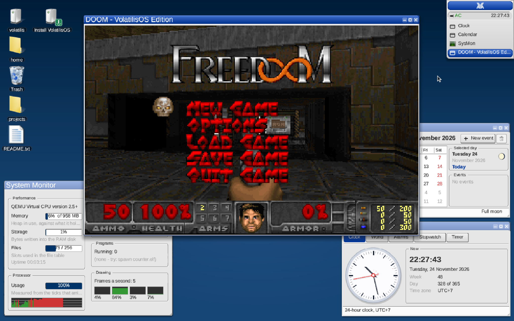
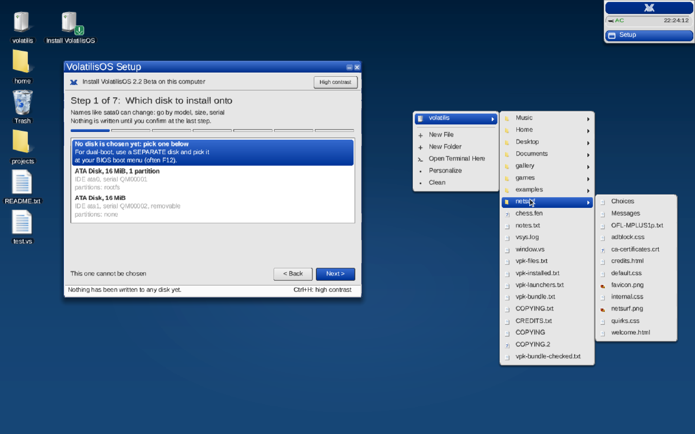
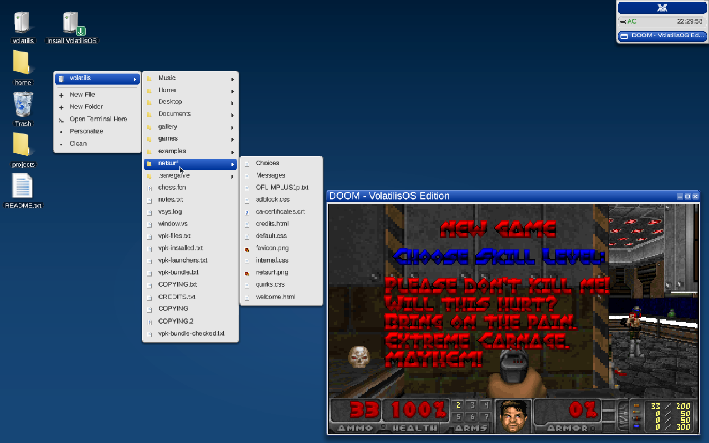
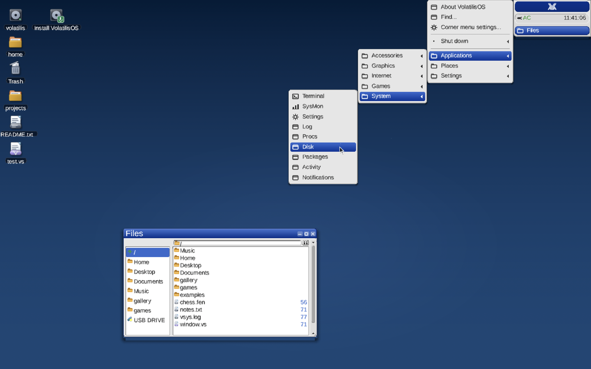
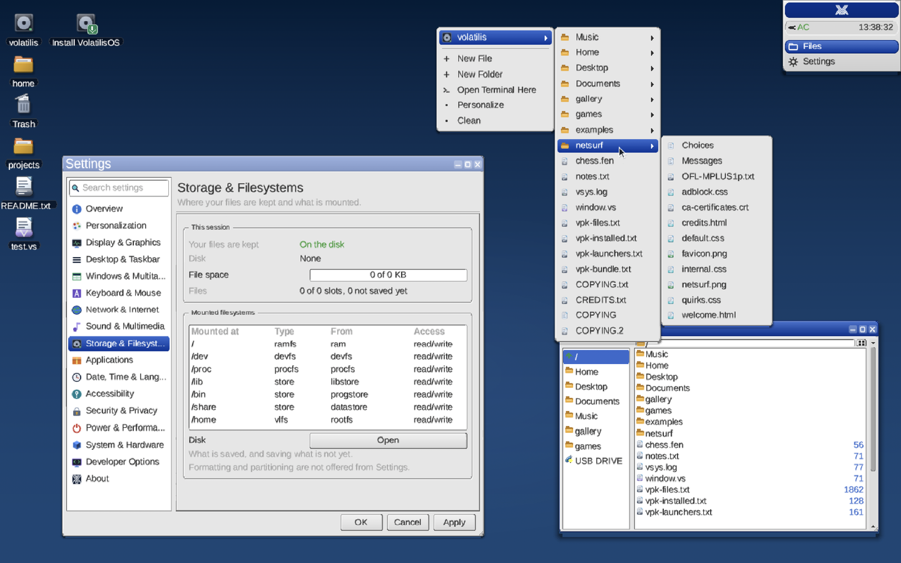
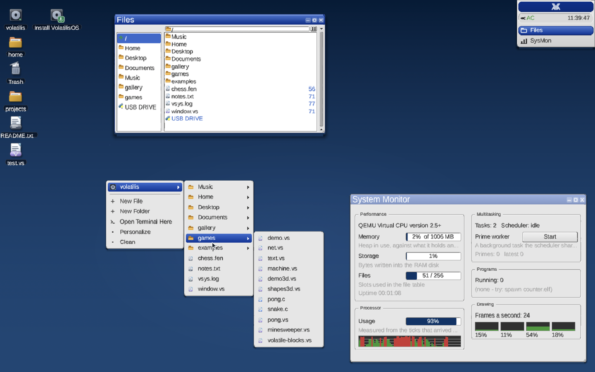
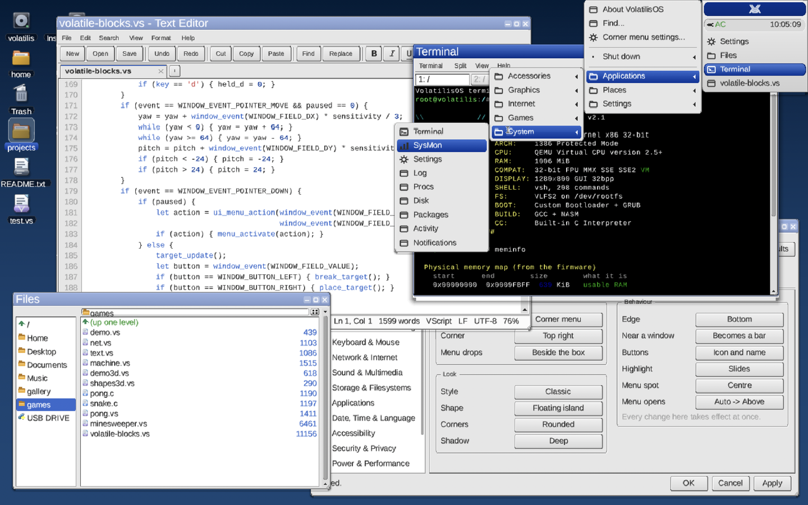
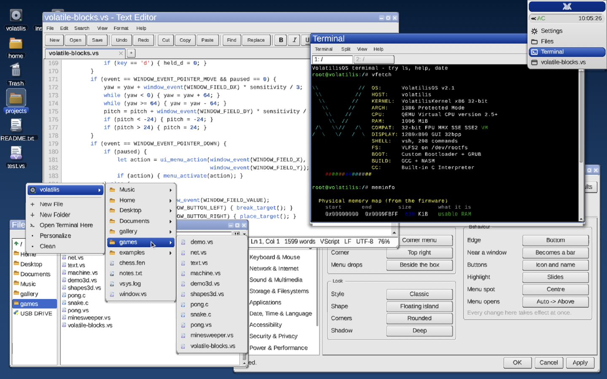
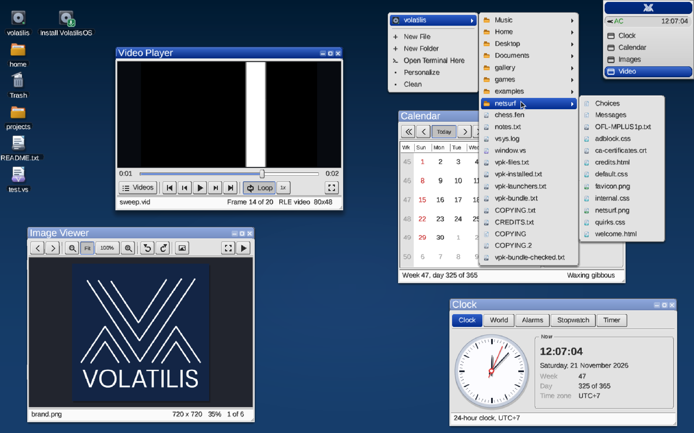
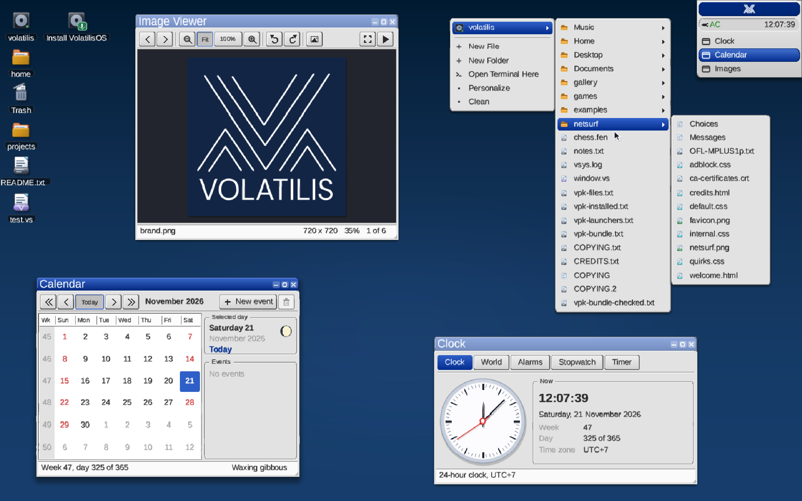

# VolatilisOS

**VolatilisOS** is an independently developed, experimental **32-bit x86 operating system** with two bootable editions: a graphical desktop (**GUI**) and a text-first command environment (**CLI**). The project began when I was 12, out of an interest in low-level programming, kernels and operating systems.

The current **published download line** is **VolatilisOS 2.2 Beta — “Navy Horizon”**. The ISO files here were rebuilt on **24 November 2026** from source commit `549e6d45` (see [What's new in this build](#whats-new-in-the-24-november-2026-build)). Development continues separately in the source repository. **The ISO files here are prebuilt snapshots; they do not update automatically when the source code changes.**

| | |
| --- | --- |
| **Published version** | 2.2 Beta — *Navy Horizon* |
| **ISO build date** | 24 November 2026, from source commit `549e6d454157675664eeb416975f50d8742b29f4` |
| **Editions** | GUI, CLI, and a master ISO containing both |
| **CPU architecture** | 32-bit x86 / i686 |
| **Recommended first boot** | QEMU or a legacy-BIOS virtual machine |
| **Release readiness** | Experimental/beta; **not certified safe for installation on real-user disks** |
| **Development source** | [VolatilisOS-source-code](https://github.com/chanatun-volatilis/VolatilisOS-source-code) (currently private) |

**Current technical status:** [What works and what's unfinished](docs/CURRENT_STATUS.md) · [Architecture](docs/ARCHITECTURE.md) · [Build and test](docs/BUILD_AND_TEST.md) · [Download & installation safety](docs/RELEASE_AND_SAFETY.md)

The original ISO verification below refers to source commit `549e6d45`. The development notes also describe later source work through `df2cc111`; these notes do not establish that the downloadable images contain the later changes. Physical-hardware support is still not certified.


*A graphical VolatilisOS desktop with Text Editor, Terminal, System Monitor and the folder menu.*

## Download — 2.2 Beta “Navy Horizon”

These files are present in this public repository. Choose the edition you want:

| Download | Description | Approximate size |
| --- | --- | --- |
| [`volatilis-gui.iso`](volatilis-gui.iso) | Standalone graphical desktop | 50 MB |
| [`volatilis-cli.iso`](volatilis-cli.iso) | Standalone text-first edition | 14 MB |
| [`volatilis-master.iso.zip`](volatilis-master.iso.zip) | Both editions with graphical and command-line installation choices; **unzip before booting** | 76 MB ZIP, about 146 MB uncompressed |

**SHA-256 checksums** (calculated for the 24 November 2026 build):

```text
e9fa4c3a9adf76bc0c8fdfdc0edc54034991fc9731e93c4e8a8ba265b3bc5f02  volatilis-gui.iso
876b32699a01517cb2f377dbf773f4708ed1bdbf6a28e78ccf31ac24638c192a  volatilis-cli.iso
78e9e014cc35fae4aa53b80f150db0018c46707f4b6d02df908ca0383442d62a  volatilis-master.iso.zip
fb173047c58080f2a1bd060efea458b7c246b6df13a92caed5f4f02d23e5385b  volatilis.iso (inside ZIP)
```

To calculate a downloaded file's checksum, use `sha256sum <filename>` on Linux or `shasum -a 256 <filename>` on macOS and compare it with the corresponding published value. A checksum is **not** a digital signature.

**Older release:** VolatilisOS 2.1 (without the newer installer flow) is archived on the [`version-2.1` branch](https://github.com/chanatun-volatilis/VolatilisOS/tree/version-2.1).

## What's new in the 24 November 2026 build

This verified rebuild of the 2.2 Beta ISOs brings in the newest work from the source repository:

- **Command-line installation mode.** The boot menu now offers graphical or keyboard-only installation. The text installer can also be opened with `vos-install --cli`; guided and advanced flows reuse the same checked installer backend, target protection, write fences and installed-system verification. See [CLI installer](docs/CLI_INSTALLER.md).
- **Installed-boot pointer recovery.** The kernel re-synchronizes the PS/2/Synaptics path after firmware USB ownership is released and native EHCI/xHCI initialization completes. This addresses laptops where an external USB mouse left the trackpad out of phase, and where both pointers appeared dead after installation.
- **Five selectable icon themes.** MOD7 is the factory default, with Vista, Modern VOS, Native and Android choices in Settings. Desktop, application, folder, storage and file-type icons use the same theme manager. Editable source/document formats share the ordinary text-document icon.
- **Host build portability.** Linux and macOS use the existing Make pipeline. Windows hosts use the documented WSL 2 PowerShell bridge so the same GNU cross-toolchain, GRUB and xorriso build runs rather than an incompatible MSVC build.

- **Clean, factory-fresh discs.** The ISOs no longer carry any of the creator's own settings, accounts or files. Every disc now boots into factory settings, and the build refuses to finish if any personal state slips onto the disc.
- **USB mouse fix on older laptops.** VolatilisOS can now drive **EHCI (USB 2.0)** controllers and **USB hubs**, so a USB mouse that sits behind a hub works. Combined keyboard-and-mouse wireless receivers now have both halves (keyboard *and* mouse) working.
- **Setup opens as a desktop window.** On the live desktop, *Install VolatilisOS* now opens Setup as a normal window instead of taking over the whole screen, and it is drawn in the same style as Settings and the other redesigned apps.
- **Modernized on-screen keyboard.** The screen keyboard was rebuilt with a full layout, bigger keys and the system theme's look. Keys now have 3D depth and visibly push in when pressed.
- **New "3D buttons" setting.** An optional setting gives buttons a keyboard-key look with a short press animation. It is off by default.
- **Read-only `.iso` support.** VolatilisOS can now open ISO 9660 disc images (`.iso` files) and browse the files inside them. This is **read-only**: you can look at and copy files out, but not change the image.

The uploaded images passed package, dual-kernel, smoke, ISO-menu and installed-disk QEMU verification. They remain experimental: please begin in a virtual machine, as described below.

## Run it safely

The simplest test is an **isolated QEMU virtual machine**:

```sh
# In the directory containing the downloaded images:
qemu-system-i386 -m 1024 -cdrom volatilis-gui.iso -boot d
qemu-system-i386 -m 512  -cdrom volatilis-cli.iso -boot d

# Master edition selection menu:
unzip volatilis-master.iso.zip
qemu-system-i386 -m 1024 -cdrom volatilis.iso -boot d
```

The commands above do not attach a host hard drive. In VirtualBox, start with an “Other / Unknown” 32-bit guest, **BIOS firmware**, one CPU, and 1 GB RAM. If you want to explore the installer, use a **new disposable virtual disk**, never a drive holding important data. Please read [installation and release-safety guidance](docs/RELEASE_AND_SAFETY.md) first.

## What's in VolatilisOS 2.2 Beta

The 2.2 *Navy Horizon* release description includes a GRUB edition-selection menu, redesigned boot splash, windowed installer, Settings app, sign-in/lock screens, system tools, updated file manager and graphical applications.

The **current source tree** also contains a substantially expanded architecture:

- **Two separate kernels:** GUI and CLI build/boot independently, sharing selected components and versioned userspace interfaces.
- **System software:** scheduling, ELF programs, file descriptors, VScript, C/C++ toolchain/SDK work, VPK packages and a selection of third-party ports.
- **Storage:** VFS, VLFS2, FAT read/write, read-only ext-family/exFAT/NTFS adapters, BIOS installer workflows and QEMU storage safety tests.
- **Graphics and applications:** desktop compositor, text editor, system utilities, media/image viewers, scalable rendering/font work, package-supported NetSurf browser and DoomGeneric/Freedoom.
- **Networking and devices:** IPv4/IPv6, TCP/UDP, DNS, TLS, Ethernet and several virtual hardware drivers.

**Not finished / not certified:** Wi-Fi cannot currently scan or join networks using the implemented radio driver; UEFI installation and Secure Boot are unsupported; broad real-GPU acceleration and SMP are not implemented; installer safety on physical drives has not been certified. Some library/port features are partial, and hardware-specific behavior varies. See the [status matrix](docs/CURRENT_STATUS.md) for evidence and limits.

## Native applications and third-party ports

VolatilisOS uses its own C/C++ cross-development SDK, ELF loader, versioned
ABI and VPK package manager to run native applications. The development tree
includes the NetSurf browser, Calculator and DoomGeneric/Freedoom integration.

**DoomGeneric and Freedoom:** the native i386 ELF engine runs in userspace,
not in a DOS or Linux emulator. A C backend presents 320 × 200 indexed-color
frames to the VOS compositor, with windowed and fullscreen rendering,
keyboard input and relative mouse capture. Freedoom 0.13.0 Phase 2 supplies
the freely licensed game resources separately at `/share/freedoom2.wad`.
Doom sound, multiplayer and reliable save/load remain unfinished.

```text
exec doomgeneric.elf -iwad /share/freedoom2.wad -nosound
```

See [Third-party software](docs/THIRD_PARTY_SOFTWARE.md) for the packaging,
test evidence and limitations.

## Later development updates (not yet a new ISO publication)

The source has progressed beyond the published build: experimental VOSCast
view-only browser streaming on isolated test networks, improved device and
pointer diagnostics, desktop/menu rendering changes, and Linux ISO bootstrap
improvements. The apt-based setup uses the pinned i686-elf toolchain and
explicit C++11 host compilation for GCC 14.2.0's libcody. See
[Build and test](docs/BUILD_AND_TEST.md) for the updated instructions.
Automatic VM window resizing is not claimed as implemented.

## Screenshots

These pictures show GUI builds and desktop applications. Screenshots may represent a different development snapshot from the published ISO and are not evidence that every feature is present in that download.

<!-- BEGIN VOS NOVEMBER 24 DEMOS -->
### November 24, 2026 — desktop and native software demos

These are development screenshots supplied by the project creator. They are not a certification of a specific downloadable ISO.

| | |
| --- | --- |
|  Native DoomGeneric/Freedoom and desktop utilities |  Windowed Setup and hierarchical file navigation |
|  Freedoom in a movable desktop window | |

<!-- END VOS NOVEMBER 24 DEMOS -->

### Desktop and menus

| | |
| --- | --- |
|  Right-click a desktop folder menu |  Applications in the launcher |

### Settings and file management

| | |
| --- | --- |
|  Settings overview |  Storage settings and the folder menu |

### Files and system monitor

| | |
| --- | --- |
|  Files and System Monitor |  Launcher, Text Editor and Terminal |

### Text editor and terminal

| | |
| --- | --- |
|  Tabbed Text Editor with syntax highlighting |  Terminal with `vfetch` and `meminfo` |

### Redesigned apps: Image Viewer, Video Player, Calendar and Clock

These two pictures show the redesigned media and time apps from the **development source**. A redesign shown here may not be in the published 2.2 ISO yet.

| | |
| --- | --- |
|  Redesigned apps (1 of 2) |  Redesigned apps (2 of 2) |

## Source code and documentation

The authoritative development source is maintained in [`VolatilisOS-source-code`](https://github.com/chanatun-volatilis/VolatilisOS-source-code). It is **currently private**: a GitHub 404 is possible if you do not have access. This public repository is for distributable images, screenshots and user-facing documentation.

The old single-file `src/desktop.c`-style source layout is outdated. Current code has `kernel/core/`, `kernel/services/`, `drivers/`, `graphics/`, `filesystem/`, `networking/`, `userspace/` and `vscript/`. Read the [architecture overview](docs/ARCHITECTURE.md) before following historical build instructions.

## Project links

- [Volatilis on TikTok](https://www.tiktok.com/@alpha300332)
- [Volatilis on itch.io](https://volatilis-2033.itch.io/)

## Copyright and licensing

The source repository states **Copyright (C) 2025–2026 Chanatun Volatilis Poolcharuansin. All rights reserved.** This public repository has no root `LICENSE` file as of this documentation update. **Do not assume the VolatilisOS source is MIT-licensed or freely redistributable.** Third-party ports, fonts, tools and packaged assets have their own license terms; consult their notices. The selectable Vista and MOD7 themes are derivatives of user-supplied Windows icon archives that arrived without an open-source licence or redistribution notice. They are identified for provenance and are not claimed as original VolatilisOS artwork. Being able to download an ISO is not a blanket licence to redistribute its constituent code or artwork.
