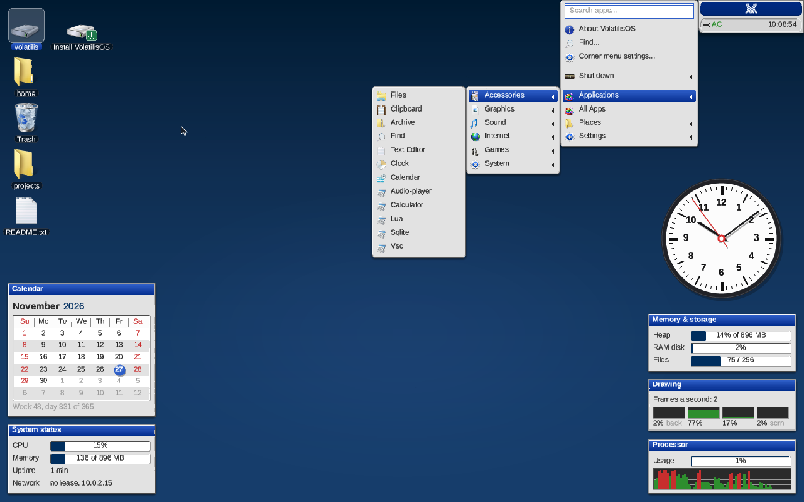
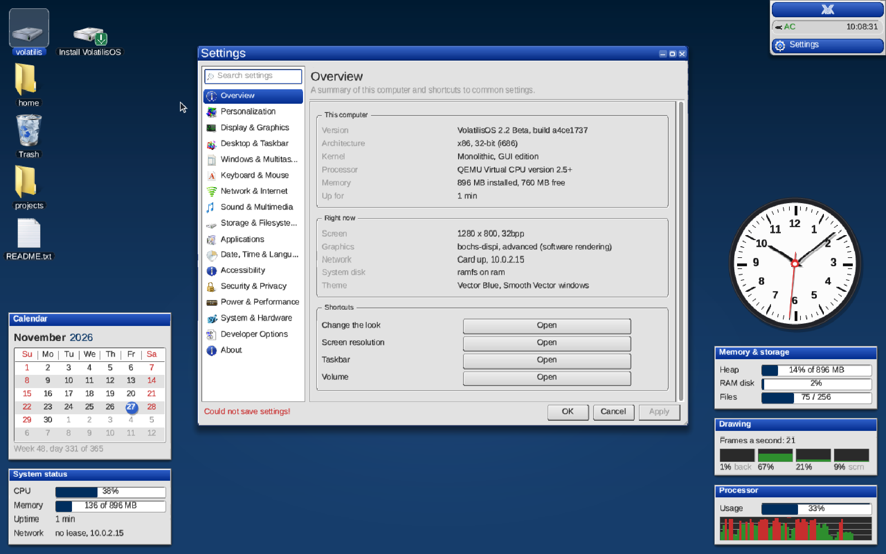
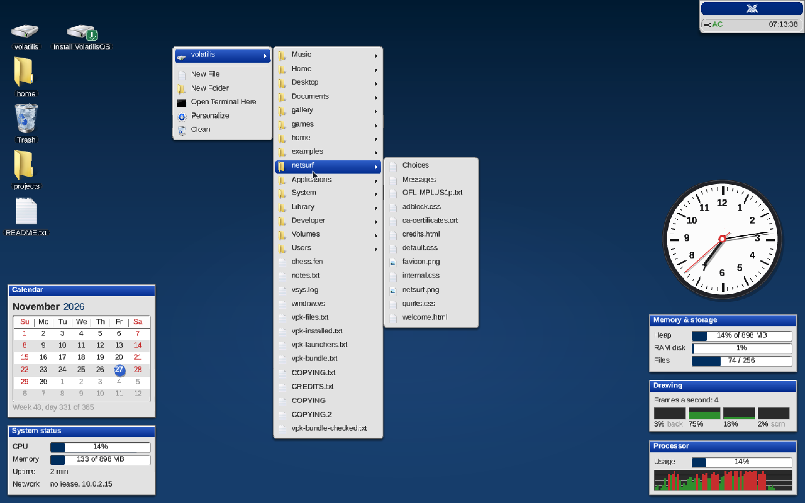
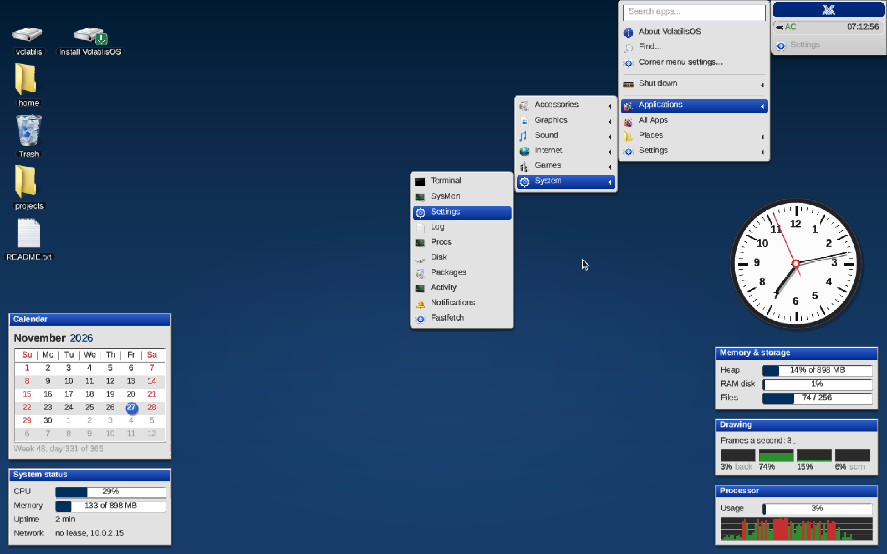
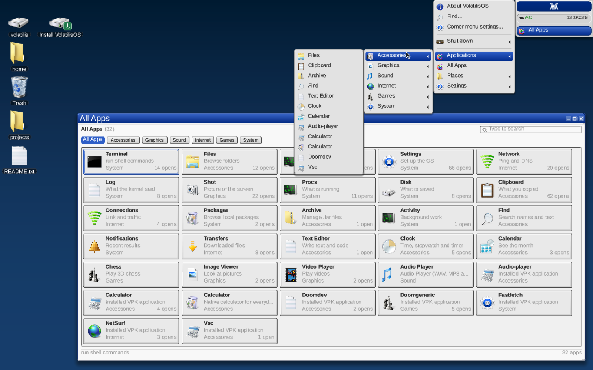
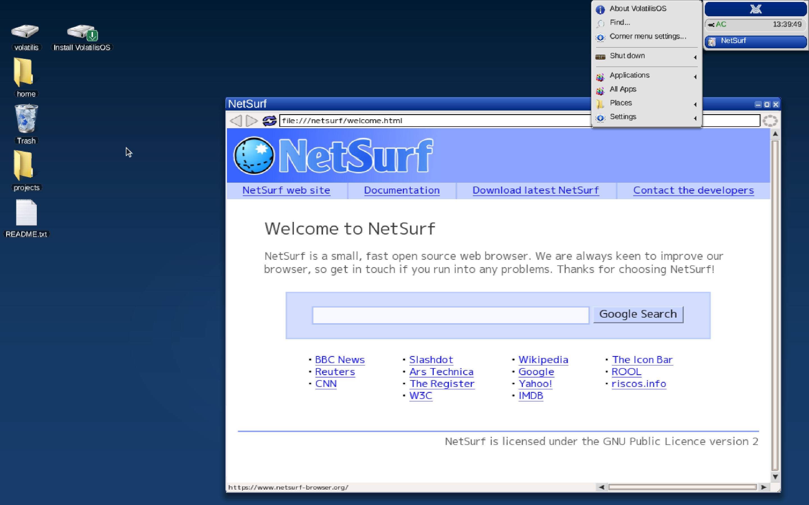
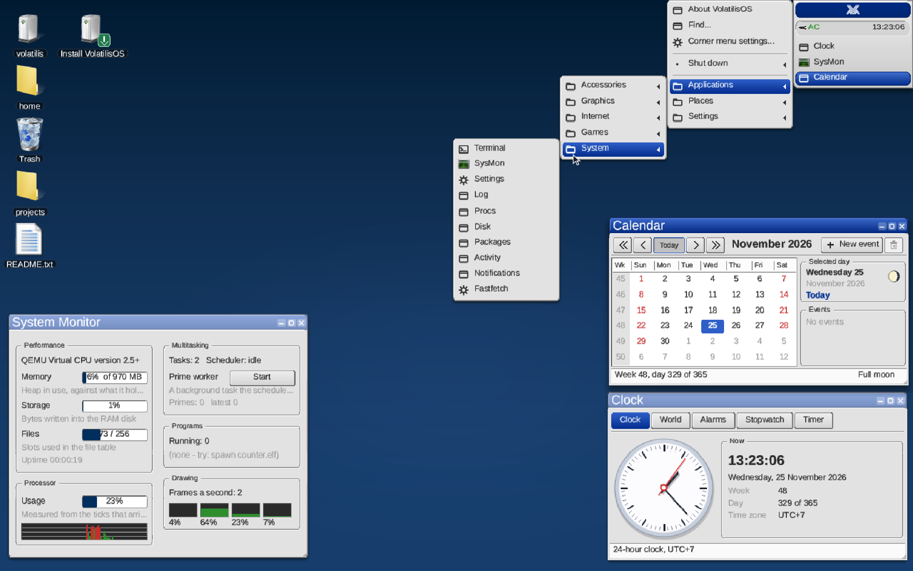

# Development screenshots: 25–27 November 2026

These seven screenshots were supplied by the project creator. They show
development builds of the VolatilisOS graphical edition, not a verified
capture of the downloadable 24 November ISO. Screens may differ from each
other as the desktop and icon themes changed. They demonstrate visible
interface behavior; they do not certify installation, hardware support, or
the state of a later source commit.

## Desktop application menus — 27 November

The desktop shows the installation launcher, cascading application menus,
calendar, clock, and live system-monitor widgets.
[Open full image](../screenshots/2026-11-27-desktop-app-menu.png).

## Settings overview — 27 November

The overview reports the GUI edition, QEMU display, network, theme, and
hardware information. **This capture also visibly reports “Could not save
settings!”** It is a development snapshot and does not demonstrate that
settings persistence is working.
[Open full image](../screenshots/2026-11-27-settings-overview.png).

## Folder navigation — 27 November

Cascading desktop folder navigation exposes the NetSurf resource directory
and its files.
[Open full image](../screenshots/2026-11-27-files-netsurf-folder-menu.png).

## System application menu — 27 November

The Applications menu groups the Terminal, Settings, package tools, process
tools, and other system utilities.
[Open full image](../screenshots/2026-11-27-system-menu.png).

## All Apps — 26 November

The searchable All Apps window lists built-in and packaged applications.
This snapshot visibly includes duplicate Calculator and Audio Player entries;
it should not be read as a polished application inventory.
[Open full image](../screenshots/2026-11-26-all-apps.png).

## NetSurf — 26 November

The native NetSurf window renders its local welcome page inside the desktop.
This image alone does not establish live Internet connectivity or site
compatibility.
[Open full image](../screenshots/2026-11-26-netsurf.png).

## Clock, Calendar and System Monitor — 25 November

An earlier development build shows the Clock, Calendar, and System Monitor
windows together. The icon style differs from the later captures.
[Open full image](../screenshots/2026-11-25-clock-calendar-system-monitor.png).
