# VolatilisOS 2.1 screenshots

All 19 of these were taken on VolatilisOS 2.1, running in QEMU, between September and November 2026. They are in the order they were taken, so you can see 2.1 change over time.

> **No installer yet.** 2.1 runs live from the disc only.

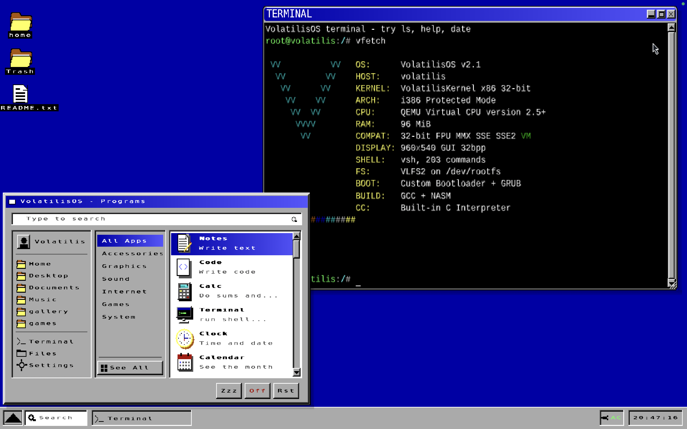
*1. An early 2.1 build with a pixel font, running `vfetch`*

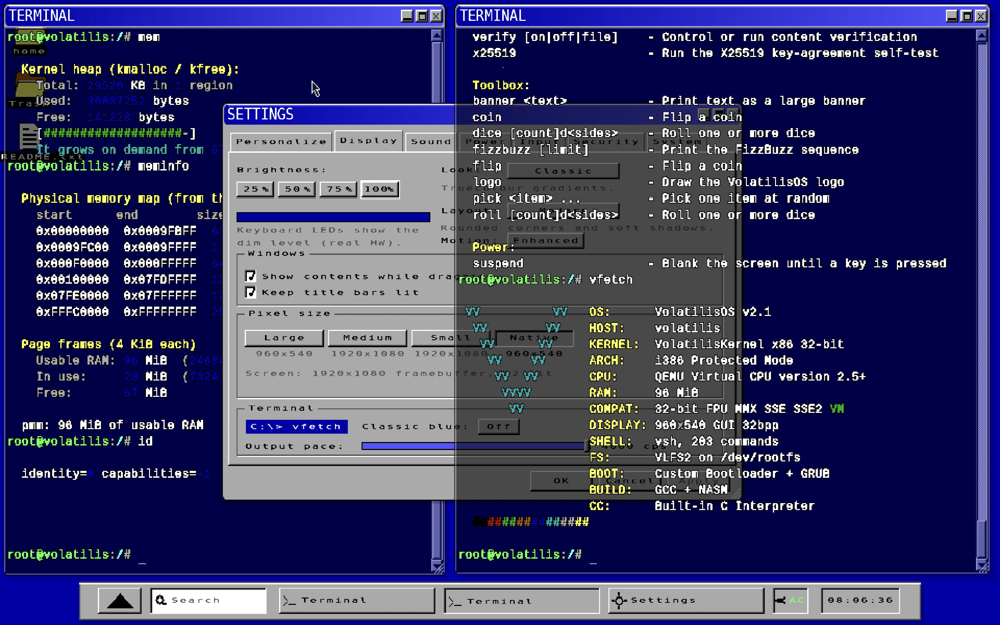
*2. Display settings: brightness, pixel size and terminal options*

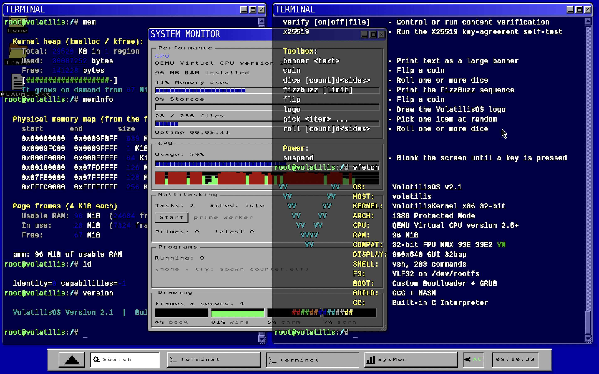
*3. **System Monitor** shows memory, storage, CPU use, tasks and frames per second*

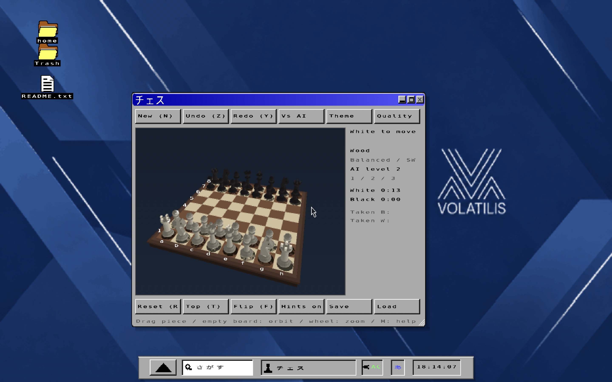
*4. **3D Chess** with the Japanese interface and the navy Volatilis wallpaper*

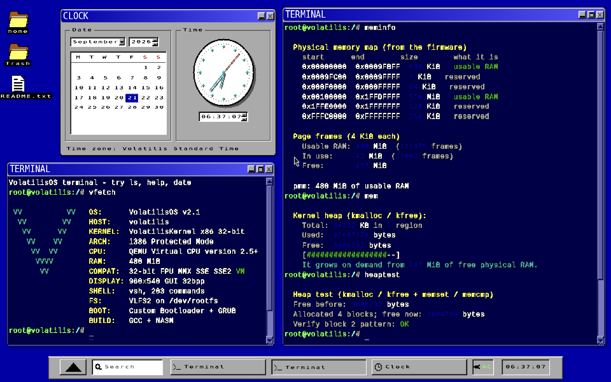
*5. **Clock** next to `vfetch`, `meminfo`, `mem` and `heaptest`*

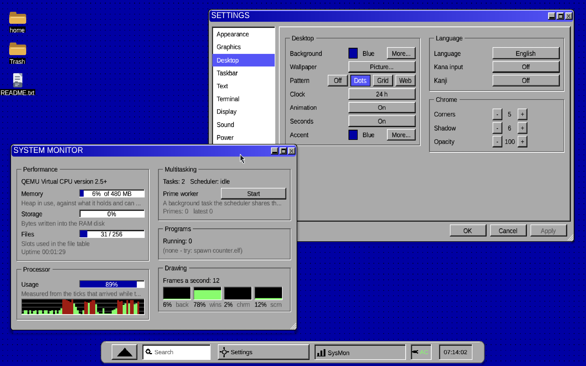
*6. **Settings**, Desktop page: background, pattern, clock, accent, language, corners, shadow and opacity*

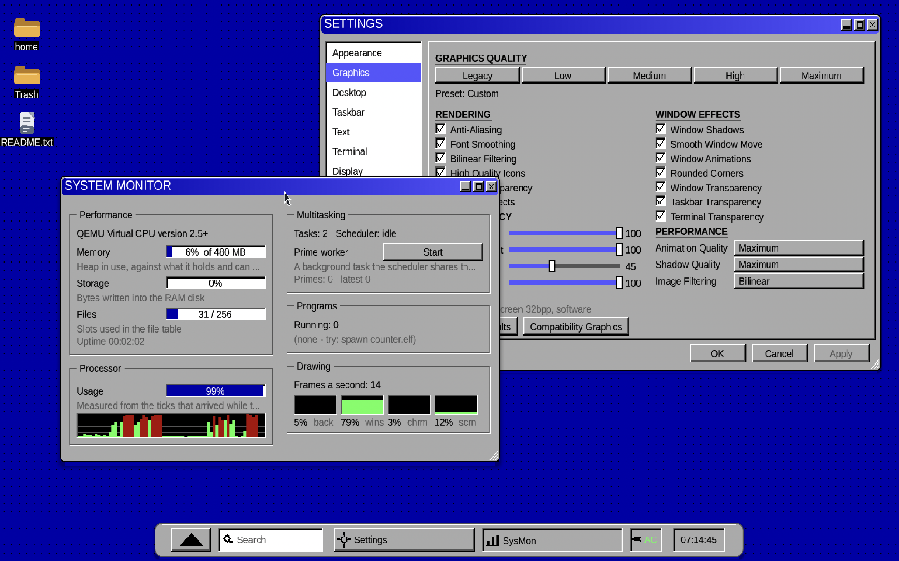
*7. **Settings**, Graphics page: quality presets, anti-aliasing, smoothing, shadows, rounded corners and transparency*

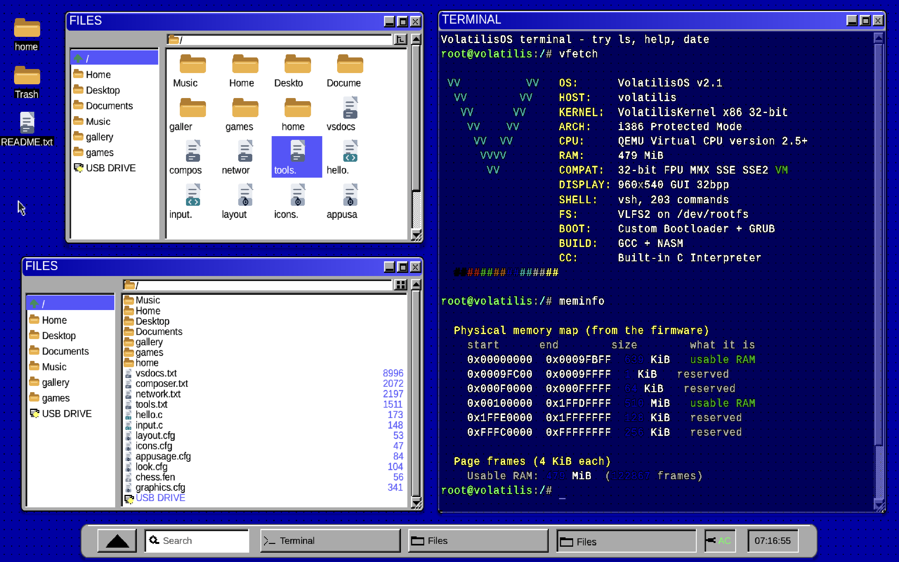
*8. **Files** in icon view and list view, with a sidebar and a **USB DRIVE***

*9. `heaptest` checks the kernel heap and shows it growing*

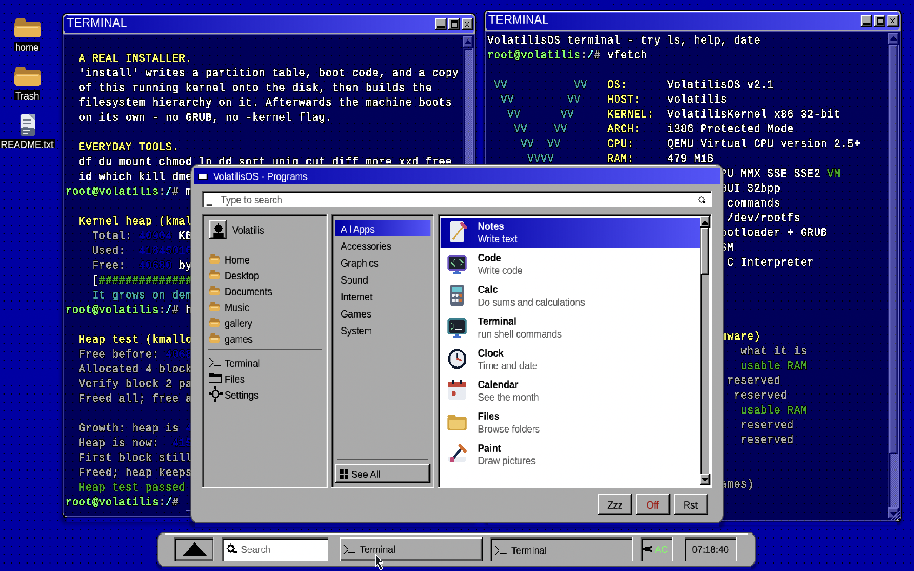
*10. The Programs menu opened over two terminals*

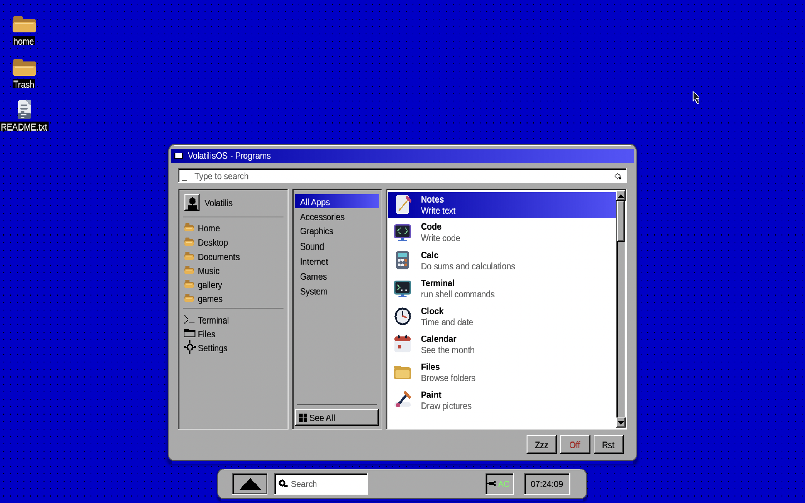
*11. The **Programs** menu, with search, places and app categories*

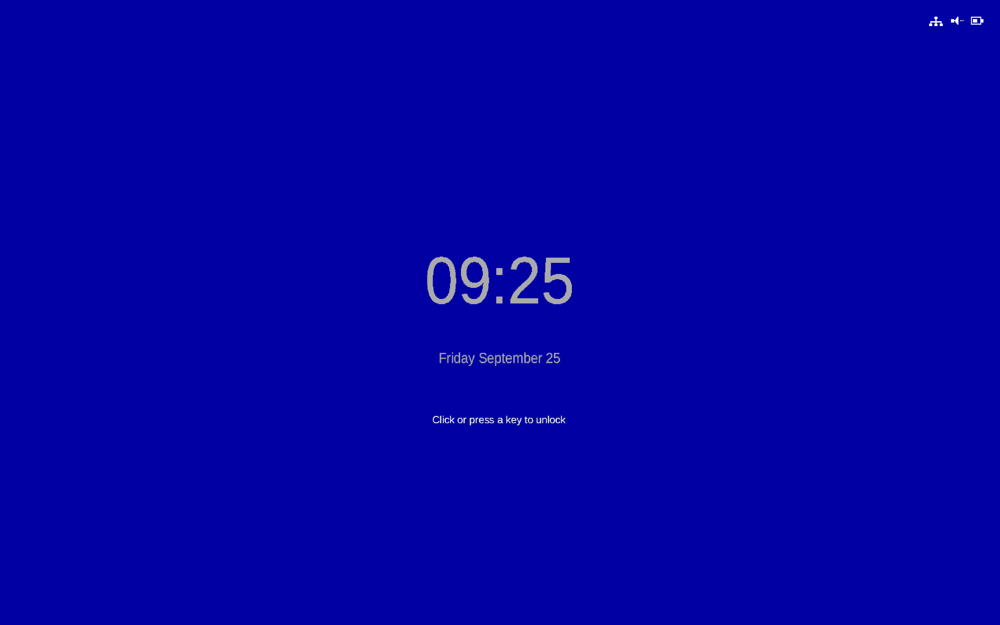
*12. The **lock screen**: click or press a key to unlock*

*13. Files next to Terminal running `vfetch` and `meminfo`*

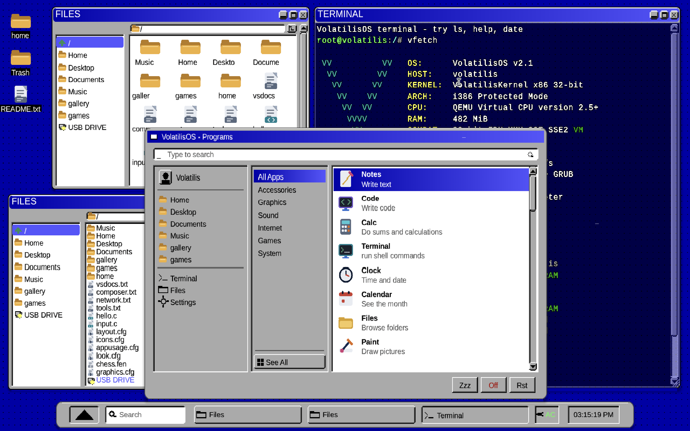
*14. The Programs menu opened over Files*

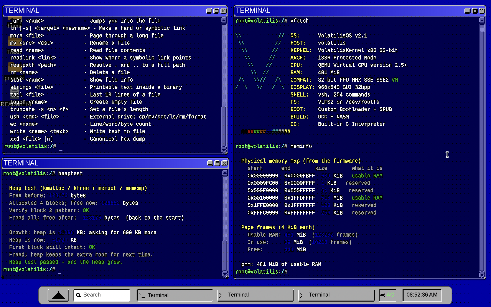
*15. Part of the `help` command list, and `vfetch` with the V-shaped logo*

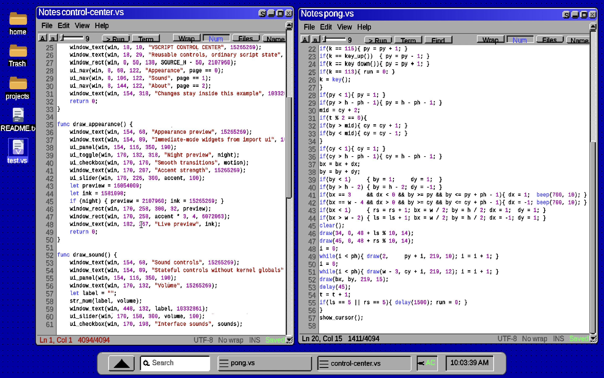
*16. **Notes** editing two VScript programs, `control-center.vs` and `pong.vs`*

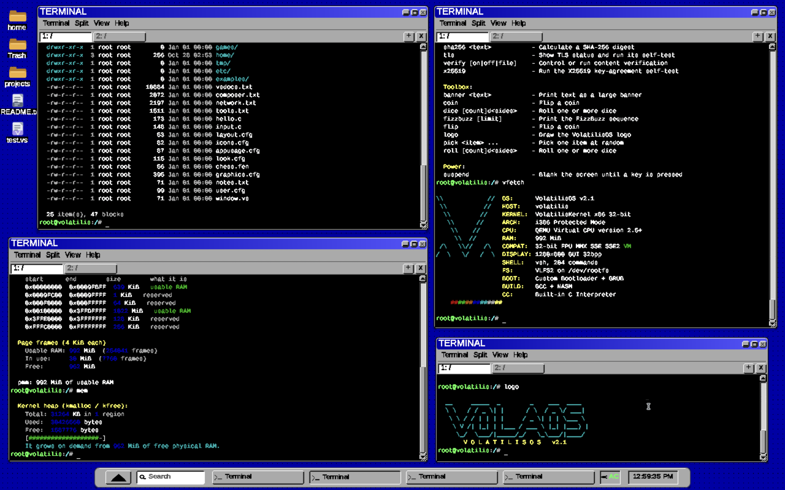
*17. Four **Terminal** windows with tabs and a Split menu, at 1280×800*

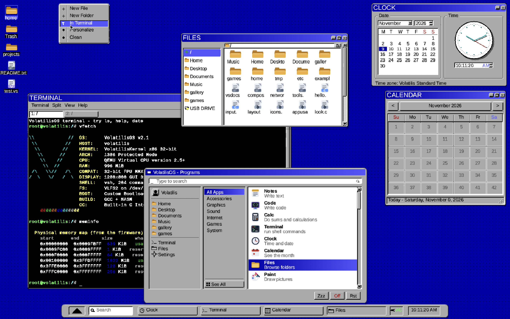
*18. Right-click the desktop for **New File**, **New Folder**, **In Terminal**, **Personalize** and **Clean***

*19. Notes with bold, colours and a ruler, reading `vsdocs.txt`, next to Clock and Calendar*
