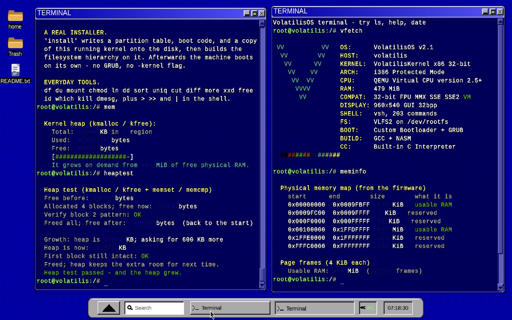
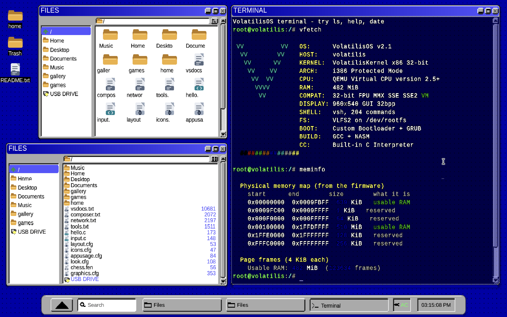
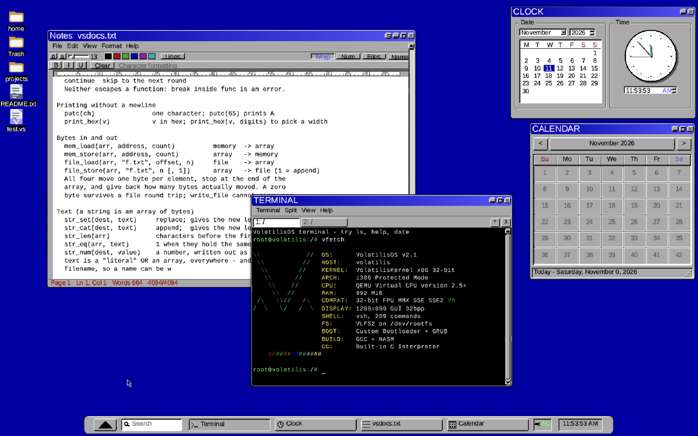

# VolatilisOS 2.1 screenshots

All of these were taken on VolatilisOS 2.1, running in QEMU, between September and November 2026. They are in the order they were taken.

> **No installer yet.** 2.1 runs live from the disc only.

*1. An early 2.1 build with a pixel font: Clock, `vfetch`, and `meminfo` / `mem` / `heaptest` in two terminals.*

*2. **Settings** (Desktop page: background, pattern, clock, accent, language, corners, shadow, opacity) and **System Monitor**.*

*3. Two **Files** windows, one in icon view and one in list view with file sizes, next to `vfetch` and `meminfo`.*

*4. The shell help text, `mem` and a `heaptest` run that shows the heap growing.*

*5. The **Programs** menu with search, places and app categories.*

*6. Files and Terminal (`vfetch` reports 204 commands and 482 MiB RAM).*

*7. The Programs menu opened over the Files windows.*

*8. The command list, `heaptest`, and `vfetch` with the new V-shaped logo.*

*9. **Notes** editing two VScript programs: `control-center.vs` and `pong.vs`.*

*10. Four terminals with tabs and a Split menu: `ls -l`, help, `vfetch` at 1280×800, `meminfo` and `logo`.*

*11. The desktop right-click menu, Files, Terminal, Clock, Calendar and the Programs menu.*

*12. Notes with text formatting reading `vsdocs.txt`, Terminal (209 commands), Clock and Calendar.*
